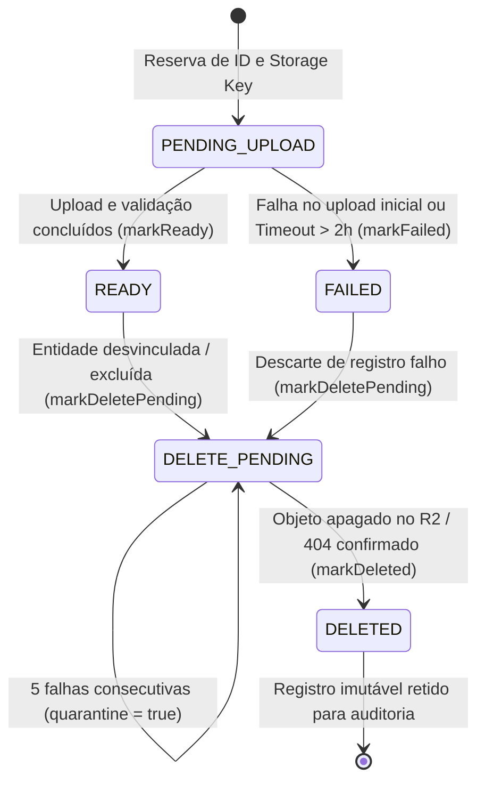

# Asset Status

O status de um asset representa a situação persistida do registro no PostgreSQL em relação aos seus bytes físicos no Object Storage (Cloudflare R2).

Ele separa de forma estrita a **disponibilidade de negócio** (se o arquivo pode ser consumido pela aplicação) da **disponibilidade de infraestrutura** (se os bytes já foram alocados ou desalocados no bucket).

---

## 1. Dicionário de Estados

| Status | Significado de Negócio | Visibilidade para a API | Responsável pela Transição |
|:---|:---|:---|:---|
| `PENDING_UPLOAD` | Identidade, propósito e storage key foram reservados. Aguarda upload e confirmação dos bytes. | Oculto (exceto em fluxos de upload sob lock) | Use case de reserva / criação de asset |
| `READY` | Arquivo processado, validado e armazenado com sucesso. Metadados e checksum confirmados. | **Visível** (único estado utilizável em galerias e perfil) | Use case de confirmação / upload |
| `DELETE_PENDING` | O vínculo de negócio foi removido ou substituído. O asset aguarda desalocação física idempotente no storage. | **Oculto** (efeito imediato no domínio) | Use case de negócio consumidor (ex: soft delete de transaction) |
| `DELETED` | A remoção física dos bytes no Cloudflare R2 foi confirmada com sucesso (ou o objeto já não existia). Linha retida para auditoria e integridade. | Oculto | `AssetReconcilerService` no Worker |
| `FAILED` | O processamento, validação ou upload inicial falhou, ou o upload expirou por inatividade. Estado terminal. | Oculto | Use case de upload ou `AssetReconcilerService` (timeout) |

---

## 2. Diagrama de Transições de Estado

---

## 3. Comportamento Operacional dos Estados

### 3.1. `DELETE_PENDING` — Desacoplamento entre Negócio e Storage
Quando uma transação financeira ou avatar é excluído, o status muda para `DELETE_PENDING` **na mesma transação do banco**. 
- Para o usuário final, a exclusão é imediata: a query da API não lista mais o anexo;
- Para o storage, a exclusão é eventual: o worker limpa os bytes de 30 a 90 segundos depois;
- Isso impede que instabilidades de rede ou lentidão no Cloudflare R2 afetem o tempo de resposta ou a disponibilidade da API HTTP.

### 3.2. Quarentena em `DELETE_PENDING`
Se a chamada ao Cloudflare R2 falhar repetidamente (ex.: credenciais corrompidas, erro 403, indisponibilidade prolongada), o asset **não muda para `FAILED`** (pois `FAILED` é reservado para falhas de upload inicial).
- O asset permanece em `DELETE_PENDING`, mas recebe `metadata.quarantine = true` ao atingir 5 tentativas;
- Registros em quarentena são ignorados pelo poller automático do reconciliador, evitando tempestades de chamadas à API do R2 e vazamento de CPU no Worker;
- A resolução de quarentena é realizada por inspeção operacional ou intervenção administrativa.

### 3.3. Expiração de `PENDING_UPLOAD` (Uploads Zumbis)
Se um cliente inicia um upload e perde a conexão ou fecha a aba antes de enviar os bytes ao R2:
- O asset ficaria indefinidamente em `PENDING_UPLOAD`, travando limites lógicos de slots (como os 3 anexos por transaction);
- O reconciliador localiza registros em `PENDING_UPLOAD` com mais de 2 horas de inatividade e executa `markFailed('UPLOAD_TIMEOUT')`;
- O estado `FAILED` é terminal e libera a cota para novas tentativas legítimas.
