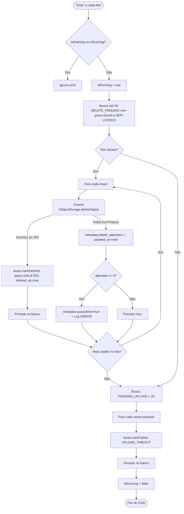

# Requirements — Asset Reconciler

## Objetivo

Implementar no processo Worker da Danfy o serviço em background `AssetReconcilerService` para garantir a desalocação física idempotente de arquivos no Cloudflare R2 e manter a integridade do ciclo de vida dos registros de `assets` no PostgreSQL, servindo como base técnica para Transaction Attachments e remoções de arquivos em toda a plataforma.

## Contexto e Fontes

- GitHub Issue [#127](https://github.com/danzSTK/personal-finance-backend/issues/127).
- Decisão canônica em `docs/assets/decisions/asynchronous-deletion-via-reconciler.md`.
- Fluxo de reconciliação em `docs/assets/flows/reconcile-assets.md`.
- Limites arquiteturais em `docs/architecture/module-boundaries.md`.
- Índice parcial existente no PostgreSQL em `1778800000000-CreateAssets.ts:66-68`:
  `CREATE INDEX "idx_assets_status_updated_at" ON "assets" ("status", "updated_at") WHERE "status" IN ('PENDING_UPLOAD', 'DELETE_PENDING', 'FAILED');`

Atualmente, `DELETE_PENDING` só avança para `DELETED` por meio do fluxo síncrono com evento outbox do avatar. Não há serviço periódico para varrer assets deletados nem uploads órfãos.

## Escopo

- Varredura periódica de assets em `DELETE_PENDING` que tenham superado a janela de carência (*grace period*).
- Remoção física idempotente no Cloudflare R2 via porta `IObjectStorage.deleteObject`.
- Transição de status para `DELETED` com preenchimento de `deleted_at = now()`.
- Gestão de erros do provedor R2 com backoff e limite estrito de tentativas (quarentena após 5 falhas).
- Varredura secundária de registros em `PENDING_UPLOAD` abandonados há mais de 2 horas, transicionando-os para `FAILED` com `failure_code: 'UPLOAD_TIMEOUT'`.
- Configuração operacional via variáveis no `worker.config.ts`.
- Métodos com bloqueio pessimista (`FOR UPDATE SKIP LOCKED`) no repositório de assets.
- Hooks de ciclo de vida no Worker (`OnModuleInit` e `BeforeApplicationShutdown`) com parada graciosa.

## Fora de Escopo

- Listagem reversa do bucket R2 (`ListObjectsV2`) para caçar arquivos órfãos não catalogados no banco.
- Remoção imediata do fluxo existente de avatar na outbox (o reconciliador atua primeiro como safety net).
- Endpoints HTTP ou alterações na API.

## Regras de Negócio

### 1. Janela de Carência (*Grace Period*)
- **WHEN** o reconciliador busca assets em `DELETE_PENDING`,
- **THE SYSTEM SHALL** filtrar apenas registros cujo `updated_at` seja anterior a `NOW() - INTERVAL '30 seconds'`.
- *Motivo:* Evitar selecionar assets cuja transação HTTP local no PostgreSQL ainda esteja em processo de commit ou finalização de I/O.

### 2. Idempotência de Desalocação
- **WHEN** a remoção física no Object Storage retornar que o objeto não existe (`NotFound` / 404),
- **THE SYSTEM SHALL** tratar a operação como bem-sucedida e avançar o asset para `DELETED`.

### 3. Isolamento de Falhas no Lote
- **WHEN** a chamada ao R2 falhar para um asset específico no lote,
- **THE SYSTEM SHALL** capturar a exceção individualmente, registrar os metadados de erro no asset e continuar processando os demais itens do lote.

### 4. Limite de Tentativas e Quarentena
- **WHEN** a exclusão física falhar por erro de rede ou instabilidade do R2 (5xx/Timeout),
- **THE SYSTEM SHALL** incrementar `metadata.delete_attempts` e atualizar `updated_at = now()`.
- **IF** `metadata.delete_attempts >= 5`,
- **THEN** o sistema marca `metadata.quarantine = true`, emite log estruturado de nível `ERROR` (`[ASSET_DELETE_QUARANTINED]`) e exclui o asset de novos ciclos automáticos.

### 5. Expiração de Uploads Abandonados
- **WHEN** um asset permanecer em `PENDING_UPLOAD` por mais de 2 horas (`updated_at < NOW() - INTERVAL '2 hours'`),
- **THE SYSTEM SHALL** transicionar o status para `FAILED` com `failure_code: 'UPLOAD_TIMEOUT'`.

### 6. Desligamento Seguro (*Graceful Shutdown*)
- **WHEN** o processo Worker receber sinal de encerramento (`SIGTERM` / `SIGINT`),
- **THE SYSTEM SHALL** sinalizar `isDraining = true`, limpar o timer do intervalo e aguardar a conclusão do batch atualmente em execução antes de encerrar.

## Fluxos Operacionais

## Critérios de Aceitação

- [ ] **AC-1:** Assets em `DELETE_PENDING` com `updated_at < now - 30s` têm seus bytes apagados no R2 e avançam para `DELETED` com `deleted_at = now()`.
- [ ] **AC-2:** Exclusão de objeto já inexistente no bucket não dispara erro e avança normalmente para `DELETED`.
- [ ] **AC-3:** Erros temporários no R2 mantêm o asset em `DELETE_PENDING`, incrementam `metadata.delete_attempts` e atualizam `updated_at`.
- [ ] **AC-4:** Assets com 5 tentativas consecutivas de falha recebem `metadata.quarantine = true`, emitem log de erro crítico e deixam de ser processados nas próximas rodadas.
- [ ] **AC-5:** Assets em `PENDING_UPLOAD` há mais de 2 horas avançam para `FAILED` com `failure_code = 'UPLOAD_TIMEOUT'`.
- [ ] **AC-6:** A query de seleção utiliza bloqueio `FOR UPDATE SKIP LOCKED` e consome o índice `idx_assets_status_updated_at`.
- [ ] **AC-7:** O worker encerra graciosamente sem abortar chamadas de desalocação em voo.
